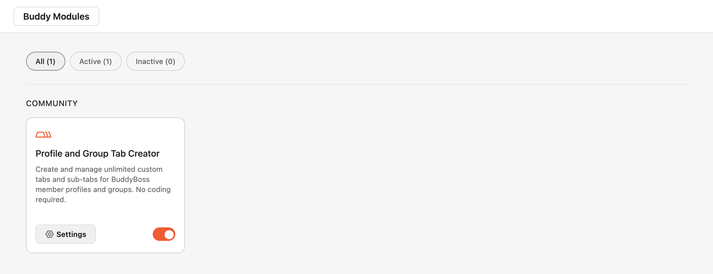
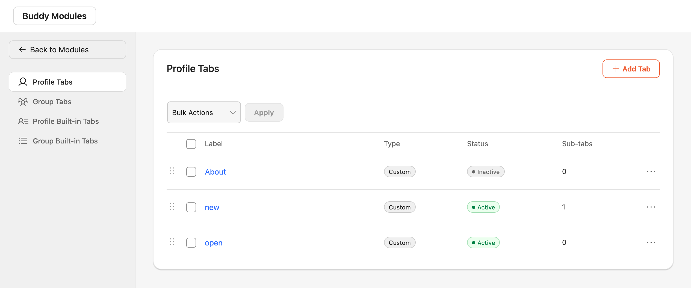

# Buddy Modules

**Free and open-source modules that extend BuddyBoss Platform.** Start with the Profile and Group Tab Creator; more modules are on the way.

- **Free & open source:** GPLv2, every line of code is here. No licence key, no upsells.
- **Modern React admin:** a fast admin panel where changes save instantly, with no page reloads.
- **On/off modules:** turn on only what you need; each module has its own settings.
- **One-click updates** from the WordPress Plugins screen.

🌐 **Website: https://rezwan2024.github.io/buddy-modules/**

## Download

**[⬇ Download the latest version (buddy-modules.zip)](https://github.com/rezwan2024/buddy-modules/releases/latest/download/buddy-modules.zip)**

This link always gives the newest release. Older versions and release notes: [all releases](https://github.com/rezwan2024/buddy-modules/releases).

Don't use GitHub's green **Code → Download ZIP** button or the "Source code" files on the releases page. Those are not installable plugins.

## Install

1. Download **buddy-modules.zip** with the link above.
2. In wp-admin, go to **Plugins → Add New → Upload Plugin**, choose the zip and click **Install Now**.
3. Click **Activate**, then open **Buddy Modules** in the admin menu.

To update an older copy by hand, upload the new zip the same way and choose **Replace current with uploaded**.

## Updates

After installing, new versions appear on the **Plugins** and **Dashboard → Updates** screens like any other plugin and install with one click. WordPress checks about twice a day; open **Dashboard → Updates** or click **Check for updates** under the plugin to check now.

## Modules

### Profile and Group Tab Creator

- Add custom tabs and sub-tabs to member profiles and groups, with your own content (shortcodes supported).
- Choose who gets a tab: user roles or chosen members on profiles; group status, chosen groups or excluded groups on groups.
- Rename, hide and reorder the built-in BuddyBoss profile and group tabs.
- Drag to reorder, bulk activate, deactivate or delete, and keep tabs as drafts.

Buddy Modules 2.0 replaces the legacy "BuddyBoss Tab Creator" plugin. Your existing tabs, rules and built-in tab changes are copied over once; the legacy data is left untouched.

## Requirements

- WordPress 6.4 or newer
- PHP 8.0 or newer
- BuddyBoss Platform 2.8 or newer

## Privacy

Update checks go through the Buddy Modules update service, which returns the latest release and counts active installs. Each check sends a one-way hash of your site address (not the address itself), the Buddy Modules, WordPress and PHP versions, and your site language. Nothing else is sent, and no cookies are set.

## Changelog

<!-- changelog -->

## Contributing

Buddy Modules is built to extend BuddyBoss Platform, never to replace it. Found a bug or want a new module? [Open an issue](https://github.com/rezwan2024/buddy-modules/issues/new).

## License

GPLv2 or later. The bundled Plugin Update Checker is MIT-licensed.
